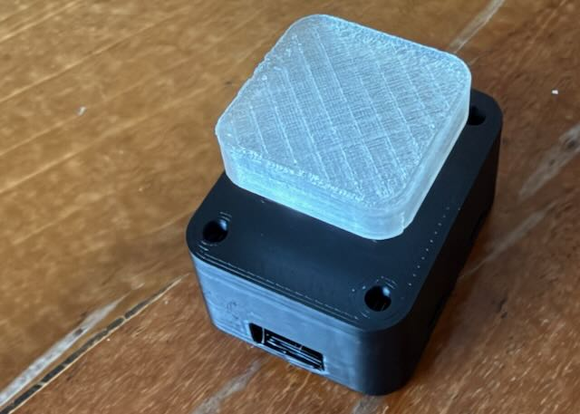
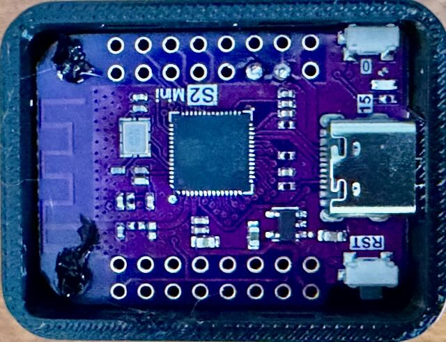

# OneButton F13

A single physical key for an ESP32-S2. A Lolin/Wemos S2 mini shows up over USB as a standard
keyboard: while the button is held, the key is held; when it is released, the key is released. No
driver or host software is needed.

It sends **F13** by default. Mac keyboards have no F13 key and macOS binds nothing to it, so it never
clashes with an existing shortcut and binds cleanly in any app. The key can be changed to any other
key or combination by editing a text file on the device. No rebuild is needed.



## Parts

- Lolin/Wemos S2 mini (ESP32-S2)
- Kailh Box Navy switch, or any MX-compatible switch
- Two short lengths of flexible wire
- Printed case parts from [_Case/](_Case/)

## Wiring

```
             Lolin S2 mini
         +-------------------+
         |  [0]       [RST]  |   <- onboard buttons
         |                   |
         |  GPIO17 o---------+------.
         |                   |      |
         |                   |    --+--   key switch
         |                   |    --+--   (normally open)
         |                   |      |
         |  GND    o---------+------'
         |                   |
         |  GPIO15 = onboard LED
         |                   |
         +------[USB-C]------+
                   |
                to the computer
```

No resistor is needed (the internal pull-up is used).



## Flash the firmware

Download `onebutton-f13-esp32-s2.bin` from the [latest release](https://github.com/l0cut15/onebutton-f13-esp32/releases/latest)
(it is also in [firmware/](firmware/)).

1. Put the board in download mode: hold **0**, tap **RST**, release **0**.
2. Open the [Espressif web flasher](https://espressif.github.io/esptool-js/) in Chrome or Edge.
3. Click **Connect** and pick the board's serial port.
4. Set **Flash Address** to `0x0`, choose the `.bin` file, and click **Program**.
5. When it finishes, tap **RST**. The board restarts as a keyboard named "OneButton F13".

Or with esptool: `esptool.py --chip esp32s2 write_flash 0x0 onebutton-f13-esp32-s2.bin`

Flashing a new version keeps your settings. **Erase Flash** wipes them.

## Bind it in an app

In the app's shortcut field, press the button. If the app offers hold or toggle, pick **hold**.

The first time it is plugged in, macOS may open **Keyboard Setup Assistant**. Close it.

## Change the key

1. Hold **0** for one second. The device restarts as a USB drive named **ONEBUTTON**, and the LED
   blinks slowly.
2. Open `CONFIG.TXT`, change the `chord` line and save:
   ```
   chord = ctrl+shift+F15
   ```
3. **Eject** the drive. About a second later it is a keyboard again, with the new chord.

Always eject before unplugging, so the file is fully written.

In the case, **0** is reached through the window in the side wall and **RST** through the hole on the
other side.

### CONFIG.TXT

One `name = value` per line. `#` starts a comment. Nothing is case-sensitive.

| Setting | Value | Default |
|---|---|---|
| `chord` | Modifiers and keys joined by `+`, at most 6 keys | `F13` |
| `max_hold_s` | Release after this many seconds held, 0 to 3600, 0 = never | `120` |

**Modifiers**: `ctrl`, `shift`, `alt` (or `option`), `cmd` (or `gui`, `win`) for the left-hand keys,
and `rctrl`, `rshift`, `ralt`, `rcmd` for the right-hand ones.

**Keys**:

| | |
|---|---|
| Letters, digits, function keys | `A`–`Z`, `0`–`9`, `F1`–`F24` |
| Editing | `space`, `enter`, `tab`, `esc`, `backspace`, `delete`, `insert` |
| Navigation | `home`, `end`, `pageup`, `pagedown`, `up`, `down`, `left`, `right` |
| Punctuation (US layout) | `grave` (`` ` ``), `minus`, `equal`, `lbracket`, `rbracket`, `backslash`, `semicolon`, `quote`, `comma`, `period`, `slash` |
| Other | `capslock`, `printscreen`, `scrolllock`, `pause`, `menu`, `mute`, `volumeup`, `volumedown` |
| Anything else | A HID usage ID in hex, `0x04`–`0xDF` |

Examples: `F13`, `ctrl+grave`, `alt+space`, `cmd+shift+F15`.

## Troubleshooting

**STATUS.TXT** on the drive shows what the device made of `CONFIG.TXT`, including any errors with
their line numbers:

```
OneButton F13 status
firmware: 2.0.0
config: ERROR, using factory default
line 4: unknown key "F31"
chord: F13
max_hold_s: 120
```

**LED**:

| Pattern | Meaning |
|---|---|
| On | Key is held |
| 3 quick blinks at start-up | `CONFIG.TXT` has an error; F13 is used until it is fixed |
| Slow blink | Drive mode |

To reset the settings, delete `CONFIG.TXT` and eject: the next start writes a fresh default file.

For firmware development, a debug build logs over UART (GPIO43, 115200 baud, needs a 3.3 V USB-UART
adapter):

```bash
idf.py -B build-debug -D SDKCONFIG=sdkconfig.dbg \
       -D SDKCONFIG_DEFAULTS="sdkconfig.defaults;sdkconfig.debug" build
```

## Build from source

Needs ESP-IDF 5.5.4.

```bash
. ~/esp/esp-idf-v5.5.4/export.sh
idf.py set-target esp32s2      # once
idf.py build
idf.py -p /dev/cu.usbmodem* flash
```

Put the board in download mode before flashing (hold **0**, tap **RST**, release **0**), and tap
**RST** afterwards.

Pins, timing and USB names are in `idf.py menuconfig` → **OneButton**. The factory chord, used when
`CONFIG.TXT` is missing or invalid, is in `main/ptt_config.h`.

## Case

About 30 x 39 x 30 mm with the keycap fitted. The STLs are in [_Case/](_Case/).

| Part | File | |
|---|---|---|
| Case shell | `OneButton_CASE_SHELL.stl` | Holds the switch and board |
| Bottom cap | `OneButton_BOTTOM_CAP.stl` | Snaps into the shell |
| Keycap | `OneButton_KEYCAP.stl` | MX stem |
| Shroud | `OneButton_SHROUD.stl` | Guides the keycap; glued on |

**Printing**: PLA, 0.4 mm nozzle, 0.2 mm layers, 3+ perimeters, 15–20% infill, no supports. Lay each
part flat: shell and shroud top face down, bottom cap floor down, keycap top down.

**Assembly**:
1. Solder about 15 mm of wire from each switch pin to the board's GPIO17 and GND pads.
2. Press the switch into the top of the shell.
3. Place the board components-down onto the two pegs inside the shell, USB-C towards the opening.
   Heat-stake the pegs with a soldering iron to hold the board.
4. Snap the bottom cap in. To remove it, press a latch in through its side window.
5. Glue the shroud onto the top, then fit the keycap.

Every dimension is in [_Case/OneButton_design_spec.md](_Case/OneButton_design_spec.md).
`_Case/onebutton_build.py` is a Fusion 360 script that rebuilds the model.

## License

MIT, see [LICENSE](LICENSE). The esp_tinyusb and TinyUSB components fetched at build time are
licensed separately (Apache-2.0 and MIT).
